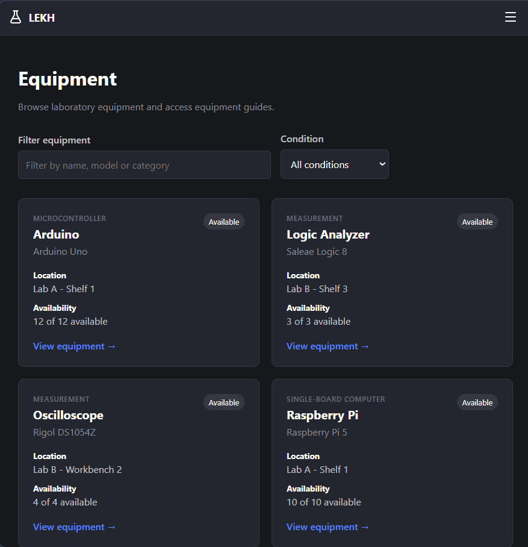
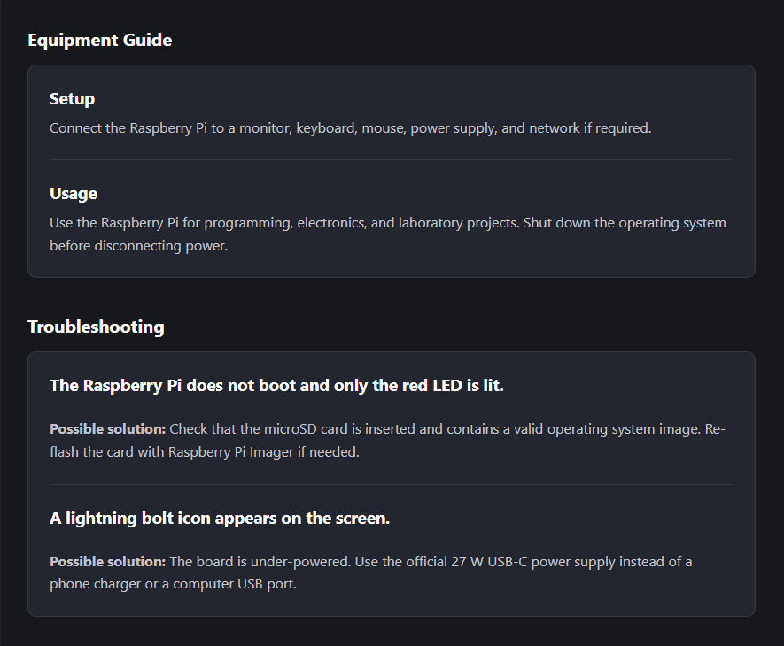
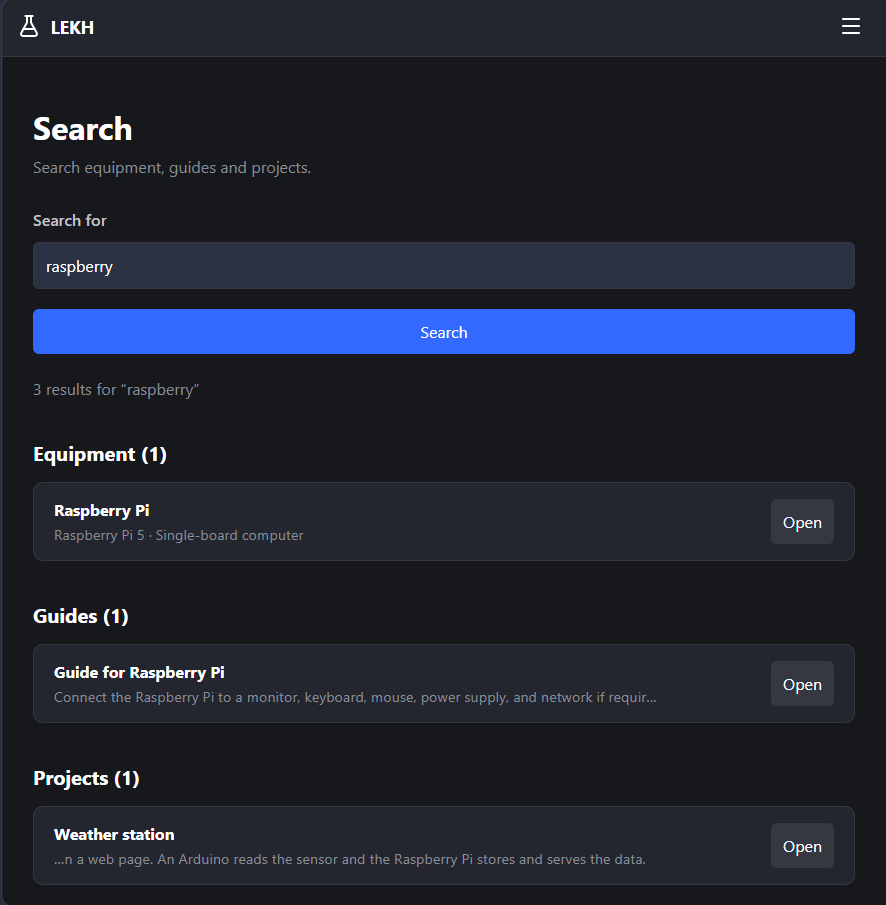
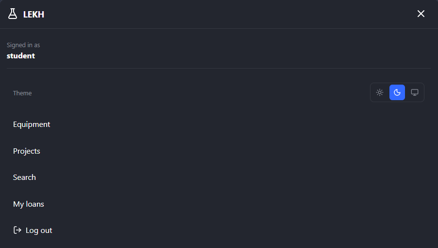
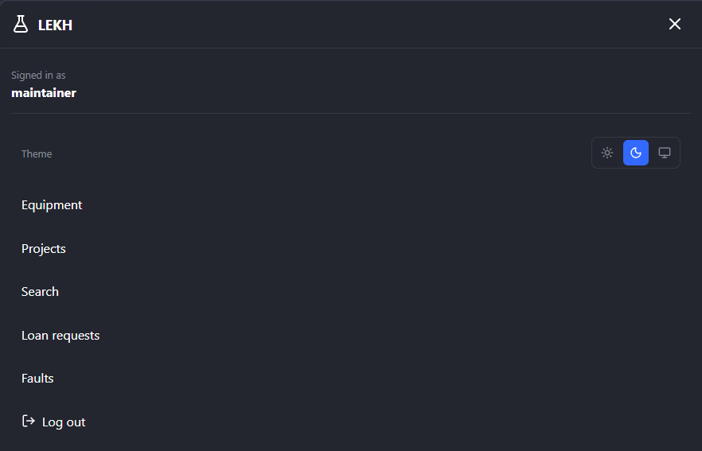
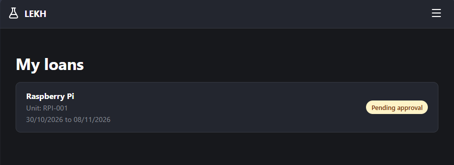
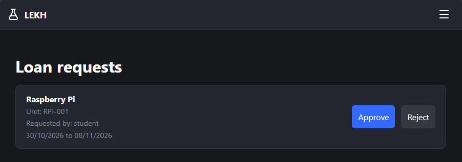

# LEKH – Lab Equipment Knowledge Hub

A full-stack web application for finding, borrowing and maintaining laboratory equipment, built for a customer during a three-sprint software development project at Blekinge Institute of Technology (PA1493, autumn 2026).

**Status:** accepted by the customer at the final demo on 21 October 2026. All 13 customer acceptance tests passed the day before, from a fresh install and an empty database. The return checklist and the light/dark themes were added after the demo.



<p>
  
  
</p>

<details>
<summary>Same app, different roles: student and maintainer menus</summary>
<p>
  
  
</p>
</details>

<details>
<summary>Loan workflow: student request and maintainer approval</summary>
<p>
  
  
</p>
</details>

## The problem

A shared student lab of electronics and computing equipment (Raspberry Pis, microcontrollers, sensor kits, 3D printers) had no central place for knowledge about that equipment. How to set something up, what usually goes wrong and how to fix it was hard to find, and it risked being lost when the staff responsible for the equipment changed.

The customer's proposal went much further: a booking timeline, QR tags, consumables, notifications, statistics and more. Two customer meetings narrowed this down to what mattered most. Equipment knowledge and guides were confirmed as the highest priority, followed by inventory, loans and fault reporting, and the customer asked for quality over a long feature list.

LEKH puts that knowledge in one place and builds the everyday workflows around it: borrowing, returning and reporting faults.

## What it does

| Role              | Can do                                                                                                                                                                   |
| ----------------- | ------------------------------------------------------------------------------------------------------------------------------------------------------------------------ |
| **Student**       | Browse and search equipment, read setup guides and troubleshooting, request loans, return equipment with a checklist, report faults, record projects that used equipment |
| **Maintainer**    | Everything above, plus manage equipment types and individual units, write troubleshooting entries, approve or reject loan requests, resolve faults                       |
| **Administrator** | Everything a maintainer can do. A separate interface for managing roles was planned but not built (see Known limitations)                                                |

Access is enforced on the server for every route, not only hidden in the interface. Borrower identities are not shown to ordinary users.

## How I worked

- **Requirements from a customer.** Two customer meetings, a requirements specification that went through eight versions, and a traceability table linking each acceptance test to its requirements and backlog issues. See [docs/requirements.md](docs/requirements.md).
- **Three sprints with demos.** The backlog lived in GitHub Issues and a project board with priority, effort and sprint.
- **One branch per backlog item**, merged through pull requests that closed the issue. The original issues and pull requests stayed in the course repository, but the merge commits in this history still show each branch name (for example `task/34-user-login`).
- **A written Definition of Done.** See [docs/definition-of-done.md](docs/definition-of-done.md).

I was the only developer. The customer was the course's customer representative.

## Tech stack

| Part     | Technology                                                                            |
| -------- | ------------------------------------------------------------------------------------- |
| Client   | React with Vite                                                                       |
| Server   | Node.js, Express 5, express-session                                                   |
| Database | PostgreSQL with Prisma 7 (schema and migrations in `server/prisma/`)                  |
| Auth     | Username and password, bcrypt-hashed, server-side sessions, role-based access control |

## Architecture

```
React (Vite)  ──/api──▶  Express 5 API  ──Prisma──▶  PostgreSQL
                          │
                          ├─ session auth (express-session, bcrypt)
                          └─ role checks per route (Student / Maintainer / Admin)
```

## Running it locally

Requirements: Node.js (LTS) and a running PostgreSQL server.

```bash
# 1. Server
cd server
cp .env.example .env          # set DATABASE_URL and a long random SESSION_SECRET
npm ci
npx prisma migrate deploy
npx prisma generate
npm run seed                  # demo data and three test accounts
npm run dev                   # API on http://localhost:4000

# 2. Client (second terminal)
cd client
npm ci
npm run dev                   # usually http://localhost:5173
```

Demo accounts (local development only): `student`, `maintainer` and `admin`, all with the password `password123`.

**Warning:** `npm run seed` empties the LEKH tables in the database that `DATABASE_URL` points to. Only run it against a development database.

<details>
<summary>Opening the app on a phone (same Wi-Fi, including WSL2 notes)</summary>

Start the client with `npx vite --host` and open the `Network:` address Vite prints, including `http://`.

If the project runs inside WSL2, forward the port from Windows (PowerShell as administrator):

```powershell
netsh interface portproxy add v4tov4 listenport=5173 listenaddress=0.0.0.0 connectport=5173 connectaddress=<WSL address from: hostname -I>
New-NetFirewallRule -DisplayName "Vite 5173" -Direction Inbound -LocalPort 5173 -Protocol TCP -Action Allow
```

Remove the rule afterwards with `netsh interface portproxy delete v4tov4 listenport=5173 listenaddress=0.0.0.0` and `Remove-NetFirewallRule -DisplayName "Vite 5173"`.

</details>

## Known limitations

Listed honestly, as they were at customer acceptance:

- An approved loan with a future start date marks the unit as on loan immediately.
- Resolving a fault does not change the unit's condition; a maintainer updates the unit separately.
- Only the borrower can return a loan; there is no staff overview of all active loans.
- New accounts always get the Student role.
- Guide version history, QR codes and role administration were confirmed by the customer but deferred, and not built.
- There is no automated test suite. Acceptance testing was manual, partly assisted by scripted browser runs.

## What I'm doing next

The course ended at customer acceptance. I'm continuing the project to make it production-ready:

- [ ] Automated tests covering the 13 acceptance tests and role-based access
- [ ] Split the server into routers, middleware and services
- [ ] Store sessions in PostgreSQL, rate-limit login attempts, secure cookie settings
- [ ] Deploy with CI/CD (GitHub Actions)
- [ ] Guide version history, part of the area the customer ranked highest

## License

Copyright © 2026 Yasaman Vallaee. All rights reserved. The code is published so it can be read and reviewed. Contact me if you want to reuse it.
